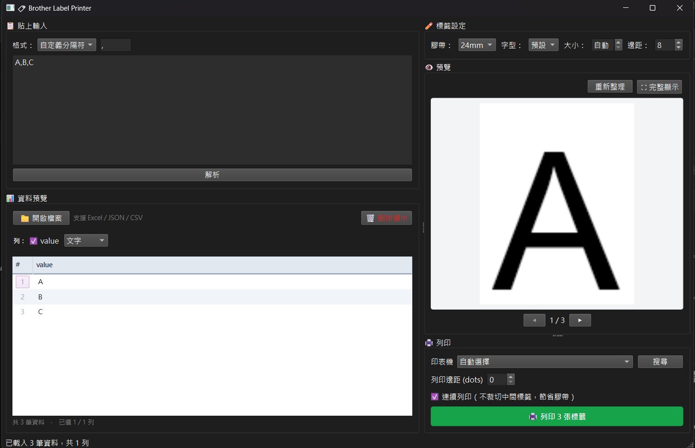
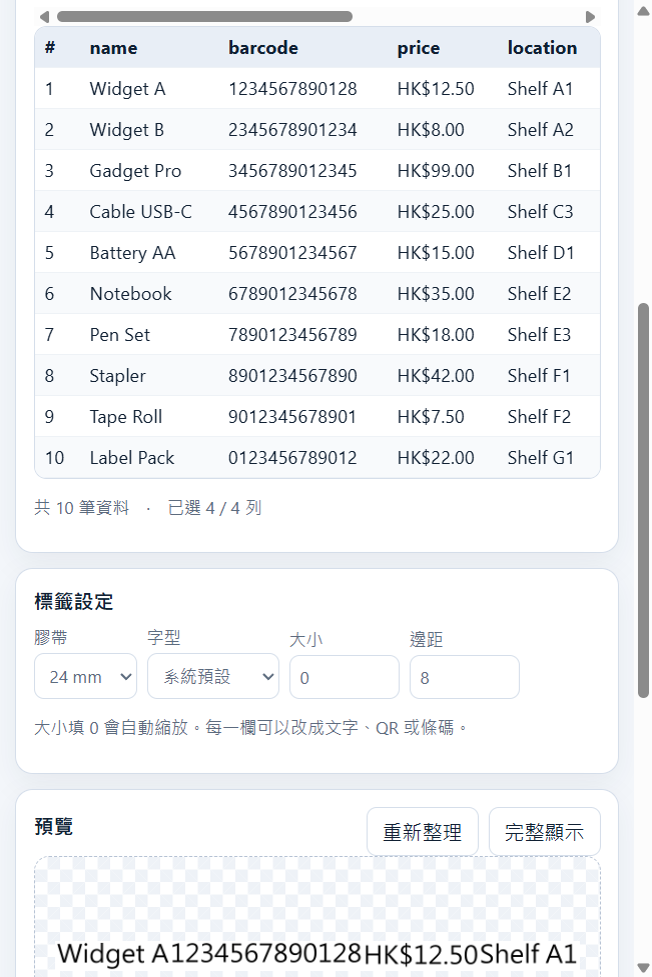
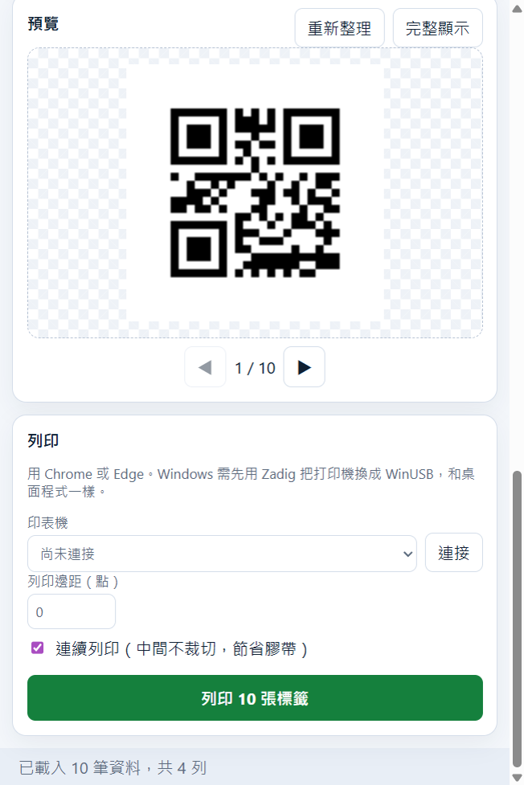

# P710BT-Auto — Brother 標籤列印

同一套標籤工具有兩個入口：瀏覽器版和桌面程式。核心都是讀資料、畫標籤、用 USB 列印 Brother PT 系列（P710BT、P750W、E550W）。

## 兩種用法

| | 瀏覽器版 | 桌面程式 |
|---|---|---|
| 怎麼開 | 用 Chrome 或 Edge 打開 [網頁版](https://wing9897.github.io/P710BT-Auto_webUI/)，可安裝到電腦 | 從 [Releases](../../releases) 下載 exe、AppImage 或 dmg |
| 資料 | 只留在你的瀏覽器，不會上傳 | 只留在這部電腦 |
| 列印 | 瀏覽器直接經 USB 送給打印機 | 程式直接經 USB 送給打印機 |

瀏覽器版是放在 GitHub Pages 的靜態網頁，給你下載到自己的瀏覽器裡使用。安裝後沒有網絡也能設計標籤。請開網頁使用，不要把 html 檔另存後雙擊，否則連不到打印機。

Windows 兩種用法都要先用 [Zadig](https://zadig.akeo.ie/) 把打印機驅動換成 WinUSB（只需做一次）。

PySide6 桌面程式不需要另外開瀏覽器。



## 瀏覽器版畫面

用 Chrome 或 Edge 打開網頁版。載入資料後可以改每一欄的類型，並即時看到標籤。

載入範例後的資料、設定與標籤預覽：



把 barcode 改成 QR、只留這一欄後的預覽和列印：



## Download

Pre-built binaries are available on the [Releases](../../releases) page — no Python installation required.

| Platform | Architecture | Format | File |
|----------|-------------|--------|------|
| Windows | x64 | Portable (no install) | `P710BT-Auto-windows-x64.zip` |
| Windows | x64 | Installer | `P710BT-Auto-windows-x64-setup.exe` |
| Linux | x64 | AppImage (no install) | `P710BT-Auto-linux-x64.AppImage` |
| Linux | x64 | DEB package | `P710BT-Auto-linux-x64.deb` |
| Linux | ARM64 | AppImage (no install) | `P710BT-Auto-linux-arm64.AppImage` |
| Linux | ARM64 | DEB package | `P710BT-Auto-linux-arm64.deb` |
| macOS | Apple Silicon (M1/M2/M3/M4) + Intel via Rosetta 2 | DMG | `P710BT-Auto-macos-arm64.dmg` |

### Usage
- **Windows (portable)**: Extract `.zip` → run `main_desktop.exe`
- **Windows (installer)**: Run `setup.exe` → desktop shortcut created automatically
- **Linux AppImage**: `chmod +x *.AppImage` → run directly (no installation)
- **Linux DEB**: `sudo dpkg -i *.deb` → run `p710bt-auto`
- **macOS**: Open `.dmg` → double-click `main_desktop.app`

> **Windows only**: Install [Zadig](https://zadig.akeo.ie/) to set up the WinUSB driver for the printer (one-time setup).

---

## 設計理念

本工具針對**批量標籤列印**場景而設計，核心概念是「資料驅動標籤」：

```
匯入資料 → 設計版型 → 即時預覽 → 一鍵批量列印
```

每一行資料對應一張標籤，程式自動將欄位映射到版型，無需逐張手動輸入。

---

## 工作流程

### 1. 匯入資料
支援多種格式直接匯入，或貼上文字：

| 格式 | 說明 |
|------|------|
| CSV | 可自訂分隔符號 |
| JSON | 陣列格式 |
| Excel | `.xlsx` |
| 貼上文字 | 自訂分隔符號解析 |

資料表預覽顯示前 50 筆，支援刪除個別行。

### 2. 設計標籤版型
- **膠帶寬度**：3.5 / 6 / 9 / 12 / 18 / 24mm（連接打印機後自動偵測）
- **欄位類型**：純文字、QR Code、Code128、Code39、EAN13
- **自動排版**：字體大小自動縮放配合標籤寬度、多行自動換行、置中對齊

### 3. 即時預覽
- 根據實際資料渲染標籤縮圖
- 支援翻頁瀏覽（前 10 張）
- 全螢幕放大預覽

### 4. 列印
- USB 直連打印機（無需驅動程式，透過 libusb）
- 自動偵測已插入膠帶寬度及餘量
- 批量列印全部資料行，顯示進度及結果
- **連續列印模式**：省去標籤之間的切割，節省膠帶

---

## 應用場景

- 倉庫貨品標籤（批量列印貨號 + 條碼）
- 活動名牌（CSV 名單 → 一鍵列印）
- 零售價格標籤（Excel 產品表）
- 資產管理（QR Code 批量生成）

---

## Features

- **Multi-format data import**: JSON array, CSV, custom delimiter, Excel (.xlsx)
- **Field types**: Plain text, QR Code, Code128, Code39, EAN13
- **Auto layout**: Auto font scaling, multi-line word wrap, center alignment
- **Tape widths**: 3.5mm, 6mm, 9mm, 12mm, 18mm, 24mm (auto-detected)
- **USB printing**: Direct USB connection via libusb
- **Batch print**: Print labels for all data rows with progress bar
- **Live preview**: Real-time label preview with pagination

---

## Run from Source

```cmd
pip install -r backend\requirements.txt
python main_desktop.py
```

Or on Windows use the provided scripts:

```cmd
install.bat          # install dependencies
start.bat            # launch app
```

**Prerequisites**: Python 3.10+

## Architecture

```
main_desktop.py       PySide6 desktop GUI (entry point)
web/                  Browser app published to GitHub Pages
  index.html          Page
  manifest.webmanifest  Installable app (PWA)
  sw.js               Offline cache
  js/                 Import, preview, QR, barcode, WebUSB print
backend/
  app/
    printer/          USB transport + Brother PT raster protocol
      constants.py    Protocol constants, printer IDs, tape margins
      transport.py    USB transport (libusb)
      protocol.py     Brother PT command builder + printer driver
      raster.py       Image → raster data conversion
    services/
      data_parser.py  Multi-format data parser
      label_renderer.py  Label rendering engine (Pillow)
```

推上 `main` 後，GitHub Actions 會做三件事：為這次提交打上版本標籤、打包各平台桌面程式並發佈到 Releases、把 `web/` 發佈到 GitHub Pages。
